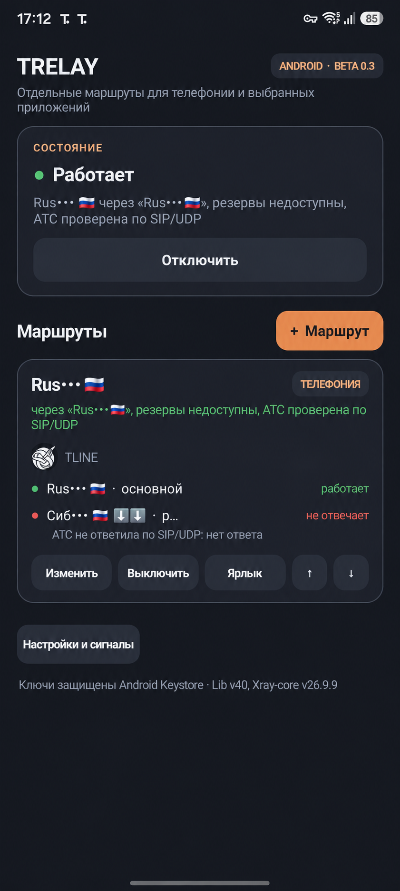
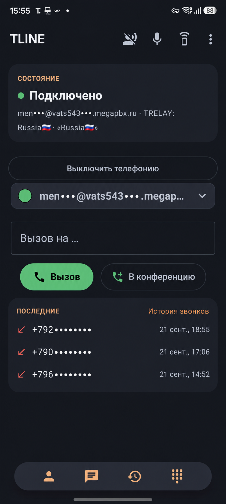

<div align="center">

# TRELAY

**Выборочная маршрутизация для стабильной телефонии за рубежом**

Windows · Android · Beta 0.3

</div>

TRELAY пропускает VPN-трафик только выбранных приложений. Основной сценарий — корпоративная или SIP-телефония для людей, которые находятся за рубежом: телефонный клиент получает нужный маршрут и российский адрес, а браузер, мессенджеры и остальные приложения продолжают работать через обычное подключение.

TRELAY создавался с нуля как самостоятельное приложение: интерфейс, управление маршрутами, переключение резервов, проверки доступности, оповещения и интеграция с телефонией написаны специально для проекта. Для самих туннелей и системной маршрутизации используются перечисленные ниже открытые движки и библиотеки.

## Как это работает

- Для каждого маршрута выбираются конкретные приложения и один или несколько VPN-серверов.
- TRELAY проверяет активный сервер и прогревает резервы.
- При сбое маршрут переключается, не отправляя трафик выбранного приложения напрямую.
- Приложения вне маршрута не попадают в VPN и не теряют обычный доступ к интернету.
- Несмотря на акцент на телефонии, через TRELAY можно направить браузер, мессенджер или любое другое поддерживаемое приложение.

## Windows и Android

| Windows | Android |
| --- | --- |
| Маршрутизация выбранных процессов через ProxiFyre | Системный per-app VPN через `VpnService` |
| Xray и Mihomo включены в portable-архив | Xray и Mihomo включены в APK |
| Ключи защищены учётной записью Windows | Ключи защищены Android Keystore |
| Подходит для настольных SIP-клиентов и рабочих приложений | Рассчитан на постоянную мобильную телефонию и быстрый failover |

## Связка с TLINE

Android-версия рекомендуется вместе с **TLINE** — отдельным SIP-клиентом проекта. При смене VPN-сервера TRELAY сообщает TLINE о новом состоянии маршрута, а TLINE сразу пересоздаёт SIP-транспорт и перерегистрируется. Это сокращает паузу после failover и повышает автономность входящей телефонии в фоне.

Связка не обязательна: TRELAY работает с Zoiper и другими приложениями. Но без прямой интеграции клиент может ждать собственного таймера перерегистрации.

<table>
  <tr>
    <td align="center"></td>
    <td align="center"></td>
  </tr>
  <tr>
    <td align="center">TRELAY Android</td>
    <td align="center">TLINE через TRELAY</td>
  </tr>
</table>

## Скачать

В одном релизе публикуются два файла:

- `TRELAY-Beta-0.3-Windows-x64.zip` — portable-сборка Windows; распакуйте архив целиком и запустите `TRELAY.exe`.
- `TRELAY-Beta-0.3-Android-arm64.apk` — сборка для современных ARM64-смартфонов.

Windows-архив нельзя разбирать на отдельные EXE: папка `engine` является частью приложения.

## Основные компоненты

- **Xray-core** — VLESS, VMess, Trojan, Shadowsocks и SOCKS-маршруты.
- **Mihomo** — дополнительные форматы конфигураций и протоколы.
- **ProxiFyre 2.6.0** — привязка приложений к маршрутам в Windows.
- **AndroidLibXrayLite 26.9.9** — встраивание Xray-core в Android.
- **SSH.NET 2024.1.0** — настройка и аудит VPS из Windows-приложения.
- **YamlDotNet 18.1.0** и **SnakeYAML 2.0** — работа с YAML-конфигурациями.
- Стандартные API Windows DPAPI, Android Keystore и Android `VpnService`.

Полные тексты и ссылки на лицензии находятся в `windows/engine`, `windows/THIRD-PARTY-NOTICES.txt` и `android/third_party`.

## Безопасность

- Пользовательские ключи, профили, runtime-конфиги и журналы не входят в репозиторий или релизные архивы.
- Windows хранит секреты через DPAPI, привязанный к учётной записи пользователя.
- Android хранит настройки маршрутов через Android Keystore и AES-GCM.
- Секрет совместимости `key://` передаётся локально во время сборки и исключён из Git.
- Опубликованные скриншоты обезличены и пересобраны без EXIF и дополнительных PNG-метаданных.

## Сборка

### Windows

Требуются .NET SDK 8 и reference assemblies .NET Framework 4.8:

```powershell
.\windows\build.ps1
```

Скрипт создаёт `artifacts/TRELAY-Beta-0.3-Windows-x64.zip` и проверяет, что runtime-конфиги и логи не попали в пакет.

### Android

Требуются JDK 17+ и Android SDK. В локальном, исключённом из Git `android/local.properties` задаются `sdk.dir` и `trelay.bootstrapSecret`.

```powershell
cd android
.\gradlew.bat :app:assembleRelease
```

## Статус

Beta 0.3 собирается из исходников для обеих платформ. Windows ZIP прошёл изолированный startup/snapshot smoke-тест. Android APK собран, выровнен, подписан совместимым сертификатом предыдущей Beta 0.3 и проверен `apksigner`/`aapt`.

Реальную SIP-регистрацию, входящий звонок, голос и расход батареи всё равно нужно финально подтвердить на целевом телефоне и у конкретного оператора: эмулятор и успешный запуск движка не заменяют полевой тест.

## Структура

```text
TRELAY/
├─ android/       Android-приложение и JVM-тесты
├─ windows/       Windows-приложение, движки и скрипт упаковки
├─ docs/images/   обезличенные скриншоты
└─ artifacts/     локальные релизные файлы, исключены из Git
```
